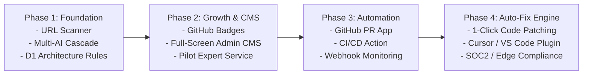

# PRBadger (prbadger.in) — Product Concept & Vision

> **"The autonomous security and architecture review engine for the AI vibe-coding era."**

---

## 1. Executive Summary

**PRBadger** is an automated code security and architectural audit platform built specifically for modern edge-first web applications and AI-generated codebases.

As tools like **Cursor, Lovable, Claude Code, GitHub Copilot, v0, and Bolt** empower developers to build full-stack applications at 10x velocity, a critical new problem has emerged: **AI writes code that compiles cleanly and passes syntax checks, but harbors catastrophic architectural, billing, and security blindspots.**

Traditional static analysis tools (ESLint, Prettier, SonarQube) only check syntactic structure and outdated CVE databases. They are completely blind to modern edge runtimes, unbatched database read explosions, client-side secret leakage, and serverless isolate boundaries.

**PRBadger bridges this gap** by combining:
1. **Zero-install instant audits** via deployed URL or repository analysis.
2. **Multi-model AI reasoning cascades** (Cloudflare Workers AI, Google Gemini 2.5 Flash, OpenAI GPT-4o) trained on real-world edge architectures.
3. **Deterministic Grounding Gate** that verifies every finding against actual bundle tokens to ensure **zero hallucinations**.
4. **Actionable Vibe Scores & Live GitHub Badges** that give developers and their users verifiable trust.

---

## 2. The Problem Landscape

### 2.1 The Rise of "Vibe Coding"
The software industry has shifted from manual line-by-line coding to prompt-driven declarative engineering ("vibe coding"). Developers describe what they want, and LLMs generate complex React components, Cloudflare Worker routes, and database schemas.

### 2.2 The Silent Traps of AI-Generated Code
While AI code works on first click, it routinely creates:
* **Cloudflare D1 & Database Billing Traps**: AI models frequently construct unindexed queries and $N+1$ loops inside request handlers that read millions of database rows, exhausting free tiers and generating shock bills within days.
* **Isolate Memory & CPU Overruns**: Serverless edge environments have strict memory (128MB) and CPU time limits. AI code commonly includes unoptimized memory buffers and unstreamed responses that crash edge workers under moderate traffic.
* **Client-Side Secret & Token Leaks**: LLMs often place admin keys, Supabase service-role keys, or private webhook secrets into client-bundled frontend code (`VITE_*` / `NEXT_PUBLIC_*`).
* **Broken Authorization Boundaries**: AI models build working UI flows but omit server-side authorization checks on background mutation routes.
* **Security & Injection Holes**: Unsanitized HTML rendering, insecure redirect handling, CSV formula injections, and delimiter breakout vulnerabilities in downstream LLM prompts.

### 2.3 Why Existing Tools Fail
| Dimension | Traditional Linters (ESLint, Prettier) | Legacy SAST (SonarQube, Snyk) | PRBadger |
|---|---|---|---|
| **Setup Barrier** | Requires npm install, configuration files | Complex enterprise CI/CD setup, heavy agents | **Zero setup: Instant URL or repository scan** |
| **Edge Runtime Awareness** | ❌ None | ❌ Outdated rules for legacy VM/Docker containers | **✅ Native awareness of Cloudflare Workers, D1, KV, Vectorize** |
| **Billing & Quota Traps** | ❌ None | ❌ None | **✅ Detects $N+1$ read loops and billing explosion risks** |
| **AI Hallucination Filtering** | N/A | N/A | **✅ Grounding Gate filters out non-existent token flags** |
| **Speed to Value** | Minutes to setup | Hours/Days to integrate | **Under 15 seconds** |

---

## 3. Product Value Proposition & Solution

### 3.1 Core Promise
> *"Deploy with confidence. Know within 15 seconds whether your AI-generated app is secure, cost-optimized, and production-ready."*

### 3.2 The Three Architectural Pillars

```
+-----------------------------------------------------------------------+
|                              PRBadger                                 |
+-----------------------------------------------------------------------+
        |                                   |
        v                                   v
[1. Multi-Asset Extraction]       [2. Deterministic Static Scanner]
  - Bundle JavaScript analysis       - Hardcoded secret signatures
  - Response headers & CORS          - SSRF & redirect loop guards
  - HTML & hydration boundaries      - Known CVE & malicious patterns
        |                                   |
        +-----------------+-----------------+
                          |
                          v
        [3. Multi-Provider AI Cascade Engine]
          - Primary: Cloudflare Workers AI (Llama 3.3 / DeepSeek-R1)
          - Secondary: Google Gemini (Gemini 2.5 Flash)
          - Fallback: OpenAI (GPT-4o)
                          |
                          v
        [4. Grounding Gate (Anti-Hallucination)]
          - Verifies identified code identifiers exist in real assets
          - Discards ungrounded or speculative hallucinations
                          |
                          v
  +-----------------------------------------------+
  |  Final Vibe Score (0-100) + Remediation Steps |
  +-----------------------------------------------+
```

---

## 4. Key Product Features

### 4.1 Instant Vibe Check Scanner
* Enter any public website or staging URL (e.g. `https://my-app.pages.dev`).
* Performs full asset discovery (HTML, scripts, stylesheets, API endpoints).
* Generates an actionable **Vibe Score (0–100)** with letter grades (**A+**, **B**, **C**, **F**).
* Displays categorized findings: **Critical**, **High**, **Medium**, **Low**, and **Quality**.

### 4.2 Dynamic Live GitHub Badges
* Generates dynamic SVG shields for GitHub `README.md` files:
  ```markdown
  [](https://www.prbadger.in)
  ```
* Shows live security and architectural status to users, investors, and open-source contributors.

### 4.3 Deep Cloudflare & Edge Semantic Checks
* **D1 Query Optimization**: Identifies missing indexes and row-read traps.
* **Worker Isolate Safety**: Analyzes synchronous bottlenecks and payload size limits.
* **Security Headers**: Verifies CSP, HSTS, X-Frame-Options, and Referrer-Policy.
* **Prompt Injection Defense**: Evaluates AI-facing endpoints for delimiter breakouts.

### 4.4 Human-in-the-Loop Remediation Pilot ("Need Our Experts?")
* For founders and engineering teams who want direct fixes:
* Submit the audit report directly to the PRBadger senior engineering team.
* Human experts deliver verified pull requests with code fixes and performance optimizations within 24–48 hours.

### 4.5 Full-Screen CMS & Engineering Knowledge Hub
* Integrated admin dashboard with a dedicated full-screen content management system.
* Publishes in-depth engineering teardowns, Cloudflare best practices, and AI security guides.
* Optimized for **Google SERP** and **AEO (Answer Engine Optimization)** for LLM discovery (Perplexity, ChatGPT, Google AI Overviews).

---

## 5. Target Customer Segments & Personas

### Persona A: "The AI-First Solo Founder" (Alex)
* **Profile**: Solo engineer or non-technical founder building SaaS products using Cursor, v0, Lovable, or Claude Code.
* **Pain Points**: Builds fast, but is terrified of database billing spikes, customer data leaks, or getting hacked on launch day.
* **Value Received**: Reassurance and actionable remediation steps before launching on Product Hunt or Hacker News.

### Persona B: "The Engineering Lead at High-Growth Startup" (Priya)
* **Profile**: Managing 5–15 engineers who are all utilizing AI coding assistants.
* **Pain Points**: Code review volume has doubled; junior developers push syntactically clean PRs that hide subtle architectural bugs.
* **Value Received**: Automated pre-merge PR scans that catch edge runtime bugs and enforce security standards before deployment.

### Persona C: "The Cloudflare & Serverless Architect" (David)
* **Profile**: Senior consultant or devops engineer building serverless microservices on Cloudflare Workers, Pages, and Supabase.
* **Pain Points**: Lack of specialized tooling that understands worker memory limits, D1 query quotas, and edge bindings.
* **Value Received**: First-class tooling designed explicitly around modern edge infrastructure.

---

## 6. Business & Monetization Model

### 1. Free Community Tier (Freemium Hook)
* Unlimited public URL scans.
* Basic Vibe Score & summary report.
* Dynamic GitHub README badge.
* Access to community knowledge base.

### 2. Pro Developer ($19 / month)
* Detailed code remediation snippets and diffs.
* Private scans (unindexed/staging environments).
* Automated scheduled scans (daily / weekly health checks).
* Downloadable executive PDF reports.
* Email & webhook alert notifications on regression.

### 3. Team & CI/CD ($79 / month)
* GitHub Action integration: Automated checks on every Pull Request.
* Slack & Discord webhook alerts.
* Team member seat management.
* Priority multi-model AI cascade compute.

### 4. Enterprise & Managed Remediation Pilot ($499+ / project)
* Dedicated review by senior Cloudflare & AI security researchers.
* Direct code fixes via pull request.
* Custom architectural hardening (Cloudflare Zero Trust, D1 migrations, rate limiting).

---

## 7. Competitive Moat

1. **Edge-Native Semantics**: Built from the ground up on Cloudflare Workers; understands serverless edge execution models better than general-purpose linters.
2. **Grounding Gate Guarantee**: Eliminates the #1 complaint developers have with AI security tools—**false-positive hallucinated vulnerabilities**.
3. **Multi-Model Resilience**: Automated real-time cascade across Cloudflare Workers AI, Gemini, and OpenAI ensures zero downtime and cost efficiency.
4. **Zero-Friction Adoption**: Developers don't need to install an npm package, give repository write access, or run Docker containers. They just paste a URL.

---

## 8. Product Roadmap



* **Phase 1 (Completed)**: Core scanning engine, multi-provider AI cascade, Grounding Gate, and D1 database integration.
* **Phase 2 (Completed)**: Dynamic README badges, dedicated full-screen Blog/CMS management, pilot lead capture, and DMCA protection.
* **Phase 3 (Next)**: Official GitHub Action and PR Reviewer App that leaves inline comments on pull requests.
* **Phase 4 (Future)**: 1-click automated pull request generation for identified vulnerabilities and an official IDE extension (Cursor / VS Code).

