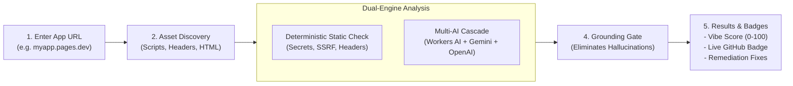

# PRBadger (`prbadger.in`)

> **The Instant Security & Architecture Vibe Check for AI-Generated Web Apps**


---

## 1. Product Concept

### What is PRBadger?
Think of **PRBadger** as **Google Lighthouse, but for Code Security and Cloudflare Edge Architecture.**

With the rise of "vibe coding" tools like **Cursor, Lovable, Claude Code, GitHub Copilot, and Bolt**, developers can build and ship full-stack web applications in hours instead of months. 

However, AI models routinely generate code that **looks perfect and compiles cleanly**, but contains hidden, dangerous traps:

* 💥 **Leaked Secrets in Client Bundles:** Private API keys (Stripe, OpenAI, Supabase Service Role) accidentally exposed in frontend JavaScript.
* 💸 **Database Billing Blowouts:** Unindexed queries and $N+1$ loops in Cloudflare D1 that exhaust monthly read limits within days.
* ⚡ **Edge Isolate Crashes:** Code that exceeds Cloudflare Workers' strict 128MB memory or CPU limits under real traffic.
* 🔓 **Missing Authorization Boundaries:** Mutation routes created without server-side permission checks.

**PRBadger solves this with a zero-friction, 15-second audit:** You paste your website or staging URL, and PRBadger automatically analyzes the live application, delivering an instant **Vibe Score (0–100)** and a verified **GitHub README Badge**.

---

## 2. How It Works



---

### Step 1: Zero-Install Instant Scan
* No npm packages, no CLI installations, and no repository permissions needed.
* Simply enter any deployed web URL (e.g., `https://myapp.pages.dev` or `https://my-saas.com`).
* PRBadger extracts script bundles, hydration boundaries, response headers, and endpoint routes.

### Step 2: Dual-Engine Security & Architecture Analysis
PRBadger runs a two-tier evaluation engine:
1. **Deterministic Static Engine:** Instantly scans for hardcoded secrets, dangerous functions (`eval`), insecure CORS policies, missing security headers, and SSRF redirect loops.
2. **Multi-Model AI Intelligence Cascade:** An autonomous AI pipeline that analyzes edge architecture traps and logic flaws. It automatically routes queries across **Cloudflare Workers AI**, **Google Gemini**, and **OpenAI** with built-in failover.

### Step 3: The Grounding Gate (0% Hallucinations)
* A common issue with AI code reviews is "hallucinated" vulnerabilities.
* PRBadger's **Grounding Gate** cross-references every AI finding against the actual identifiers and tokens in your code.
* If a flagged variable, function, or secret does not exist in the real codebase, **it is automatically dropped**. You only see verified, grounded findings.

### Step 4: Vibe Score & Live GitHub Badges
* Generates an actionable **Vibe Score (0–100)** with letter grades (**A+**, **B**, **C**, **F**).
* Provides a dynamic SVG badge ready to embed in your GitHub README:
  ```markdown
  [](https://www.prbadger.in)
  ```
* Categorizes issues by severity (**Critical**, **High**, **Medium**, **Low**, and **Quality**) with exact code explanations.

---

## 3. Quick Summary

| Stage | What Happens | Result |
|---|---|---|
| **Input** | Paste any website or staging URL | Instant headless asset extraction |
| **Analysis** | Static pattern scanner + Multi-LLM cascade | Flags security holes, billing traps & memory limits |
| **Verification** | Grounding Gate filters out false positives | 100% verified, hallucination-free findings |
| **Output** | Interactive audit report + GitHub badge | Actionable fixes & proof of security for users |
